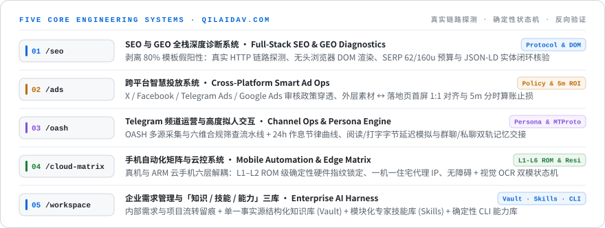

<!--
  qilaidev / qilai (qilaidav.com) — GitHub Profile
  · 所有视觉卡片由 scripts/gen_assets.py 生成为自托管 880px SVG，CI 每周一自动刷新。
  · 与个人工程工作室主站 https://qilaidav.com 及公开技术频道 @AIKB8 双向闭环对齐。
-->

  <a href="https://qilaidav.com/">
    <picture>
      <source media="(prefers-color-scheme: dark)" srcset="assets/hero-dark.svg" />
      
    </picture>
  </a>

  <a href="https://qilaidav.com/"><b>qilaidav.com</b></a> &nbsp;·&nbsp;
  <a href="https://qilaidav.com/en/">English</a> &nbsp;·&nbsp;
  <a href="https://qilaidav.com/seo/">/seo</a> &nbsp;·&nbsp;
  <a href="https://qilaidav.com/ads/">/ads</a> &nbsp;·&nbsp;
  <a href="https://qilaidav.com/oash/">/oash</a> &nbsp;·&nbsp;
  <a href="https://qilaidav.com/cloud-matrix/">/cloud-matrix</a> &nbsp;·&nbsp;
  <a href="https://qilaidav.com/workspace/">/workspace</a> &nbsp;·&nbsp;
  <a href="https://qilaidav.com/notes/">/notes (204)</a> &nbsp;·&nbsp;
  <a href="https://t.me/BD8888">@BD8888</a> &nbsp;·&nbsp;
  <a href="https://t.me/AIKB8">@AIKB8</a>

  <a href="https://qilaidav.com/#systems">
    <picture>
      <source media="(prefers-color-scheme: dark)" srcset="assets/systems-dark.svg" />
      
    </picture>
  </a>

  <a href="https://qilaidav.com/notes/">
    <picture>
      <source media="(prefers-color-scheme: dark)" srcset="assets/stack-dark.svg" />
      
    </picture>
  </a>

  <picture>
    <source media="(prefers-color-scheme: dark)" srcset="assets/activity-dark.svg" />
    
  </picture>

