<!--
  qilaidev / qlai — GitHub 主页 (视觉特化版)
  · 所有卡片由 scripts/gen_assets.py 生成为自托管 SVG，CI 每周一刷新；正文不写会随时间漂移的数字。
  · 联系方式只放邮箱；正文不写求职/招聘相关表述。
-->

  <picture>
    <source media="(prefers-color-scheme: dark)" srcset="assets/hero-dark.svg" />
    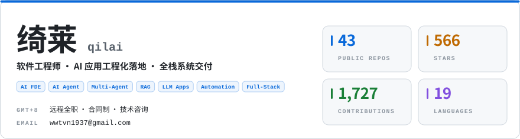
  </picture>

 

> **qlai** · 软件工程师 · `GMT+8` · <a href="mailto:wwtvn1937@gmail.com"> wwtvn1937@gmail.com </a>  
> 专注 **AI 应用工程化落地**与**全栈系统交付**。主导从架构设计、AI 能力编排到生产运维的全链路闭环，聚焦 **AI FDE** 与**企业级 Agent 架构**。

- **`韧性架构`** — 以异步状态机驱动长流程任务，结合状态持久化与幂等重试实现故障自愈；通过多层异常兜底隔离模型输出波动与外部依赖失效，保障业务连续性。
- **`生产编排`** — 基于真实高并发业务负载设计多 Agent 协同工作流，面向可对接、可观测、易排障的生产环境，将一线实战沉淀为可复用的工程模板。
- **`工程准则`** — **不追新，追稳定；构建有韧性的系统；让 AI 真实运行于生产环境。** 技术选型以稳定性、可维护性、成本与业务回报为唯一标尺。

 

  <picture>
    <source media="(prefers-color-scheme: dark)" srcset="assets/stack-dark.svg" />
    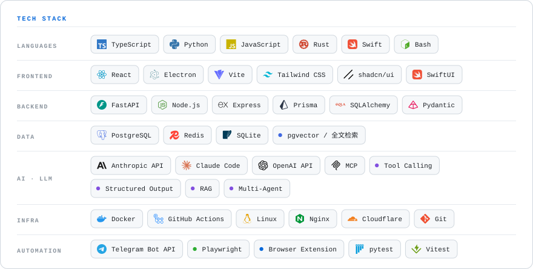
  </picture>

 

  <a href="https://github.com/qilaidev/bazi-master"><picture><source media="(prefers-color-scheme: dark)" srcset="assets/project-bazi-master-dark.svg" />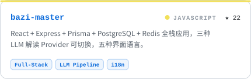</picture></a>&nbsp;&nbsp;<a href="https://github.com/qilaidev/cleanplate"><picture><source media="(prefers-color-scheme: dark)" srcset="assets/project-cleanplate-dark.svg" />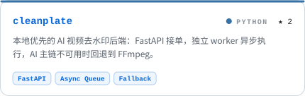</picture></a>
    
  <a href="https://github.com/qilaidev/metaphysics-engine"><picture><source media="(prefers-color-scheme: dark)" srcset="assets/project-metaphysics-engine-dark.svg" />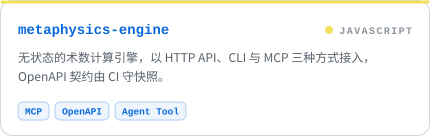</picture></a>&nbsp;&nbsp;<a href="https://github.com/qilaidev/Auto-Codex"><picture><source media="(prefers-color-scheme: dark)" srcset="assets/project-auto-codex-dark.svg" />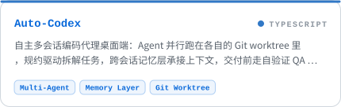</picture></a>
    
  <a href="https://github.com/qilaidev/x-account-cleaner"><picture><source media="(prefers-color-scheme: dark)" srcset="assets/project-x-account-cleaner-dark.svg" />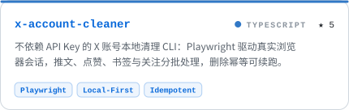</picture></a>&nbsp;&nbsp;<a href="https://github.com/qilaidev/bilibili-cleaner"><picture><source media="(prefers-color-scheme: dark)" srcset="assets/project-bilibili-cleaner-dark.svg" />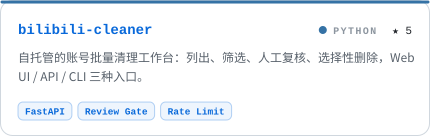</picture></a>
    
  <a href="https://github.com/qilaidev/PromptPanel"><picture><source media="(prefers-color-scheme: dark)" srcset="assets/project-promptpanel-dark.svg" />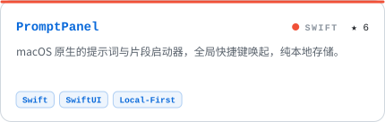</picture></a>&nbsp;&nbsp;<a href="https://github.com/qilaidev/IDM-Activation-Script-Chinese"><picture><source media="(prefers-color-scheme: dark)" srcset="assets/project-idm-activation-script-chinese-dark.svg" />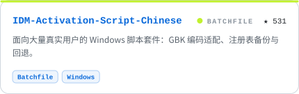</picture></a>

  更多项目见置顶仓库与 <a href="https://github.com/qilaidev?tab=repositories"> 全部仓库列表 → </a>

  <picture>
    <source media="(prefers-color-scheme: dark)" srcset="assets/activity-dark.svg" />
    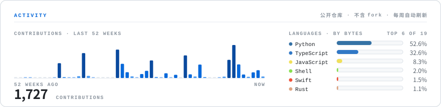
  </picture>

