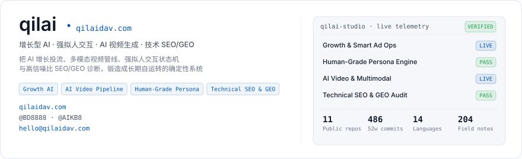
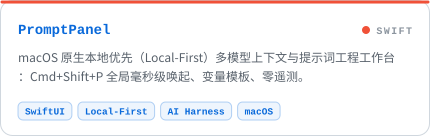
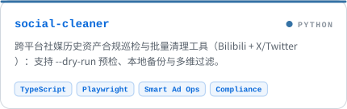
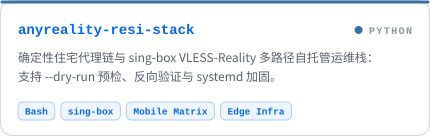
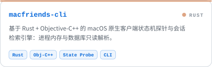
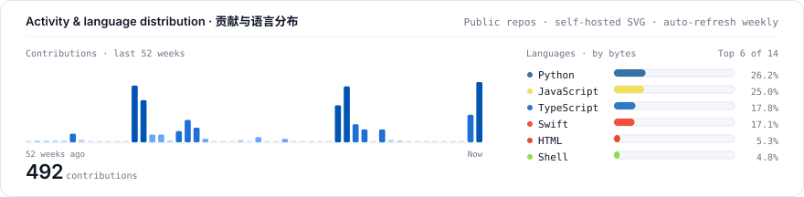

<!--
  qilaidev / qilai (qilaidav.com) — GitHub Profile & Studio Architecture Index
  · 所有视觉卡片由 scripts/gen_assets.py 生成为自托管 SVG，CI 每周一自动刷新。
  · 与个人工程工作室主站 https://qilaidav.com 及公开技术频道 @AIKB8 双向闭环对齐。
-->

  <a href="https://qilaidav.com/">
    <picture>
      <source media="(prefers-color-scheme: dark)" srcset="assets/hero-dark.svg" />
      
    </picture>
  </a>

  

    <a href="https://qilaidav.com/"><b>🌐 主站 (ZH): qilaidav.com</b></a> &nbsp;·&nbsp;
    <a href="https://qilaidav.com/en/"><b>🌐 English: qilaidav.com/en/</b></a> &nbsp;·&nbsp;
    <a href="https://qilaidav.com/notes/"><b>📓 生产排障实录与专栏 (204 篇)</b></a> &nbsp;·&nbsp;
    <a href="https://qilaidav.com/about/"><b>🧭 关于工作室 (/about/)</b></a> &nbsp;·&nbsp;
    <a href="https://t.me/BD8888"><b>✈️ Telegram: @BD8888</b></a> &nbsp;·&nbsp;
    <a href="https://t.me/AIKB8"><b>📡 频道: @AIKB8 (AI资源笔记)</b></a> &nbsp;·&nbsp;
    <a href="mailto:hello@qilaidav.com"><b>✉️ hello@qilaidav.com</b></a>
  

---

### 🏛️ 五大确定性工程系统矩阵 · Five Flagship Engineering Systems (`qilaidav.com`)

> 以 **真实链路探测（Live Protocol Probing）、确定性状态机（Deterministic State Machines）与反向验证（Negative Testing）** 为统一底层方法论，把依赖人力的复杂业务黑盒重构为可长期独立运行的生产级系统：

| 编号与架构层级 | 核心系统与双语入口 (`ZH` / `EN`) | 解决的核心生产痛点与确定性技术特征 | 关联开源工程与实测证据 |
| :--- | :--- | :--- | :--- |
| **01 · Primary Hub** `Protocol & DOM` | **[SEO 与 GEO 全栈深度诊断系统](https://qilaidav.com/seo/)** [Full-Stack SEO & GEO Diagnostics](https://qilaidav.com/en/seo/) | 剥离通用扫描器 80% 模板假阳性噪音；做真实 HTTP 重定向与边缘缓存探测、无头浏览器 DOM 渲染、标签剥离可见字符核算、SERP 62/160 单位像素预算校验与 Schema.org `@id` 实体闭环核验。 | [`qilaidev/qilaidev`](https://github.com/qilaidev/qilaidev) · [16 条假阳性与 5 处漏报复盘](https://qilaidav.com/notes/generic-seo-scanner-false-positives.html) · [SPA 首屏零字符排障](https://qilaidav.com/notes/spa-headless-zero-char-trap.html) |
| **02 · Execution Hub** `Policy & ROI` | **[跨平台智慧投放系统 (Smart Ad Ops)](https://qilaidav.com/ads/)** [Cross-Platform Smart Ad Ops](https://qilaidav.com/en/ads/) | 覆盖 **X / Facebook / Telegram Ads / Google Ads**：平台审核政策前置穿透、外层广告文案 ↔ 内层落地页/Bot 首屏 1:1 自动化对齐、5 分钟级分时算账切除空耗废花费。 | [`qilaidev/social-cleaner`](https://github.com/qilaidev/social-cleaner) · [多平台内容合规预检工作流](https://qilaidav.com/notes/social-media-content-compliance-preflight.html) |
| **03 · Execution Hub** `Persona & MTProto` | **[Telegram 频道运营与高度拟人交互系统](https://qilaidav.com/oash/)** [Telegram Ops & Persona Engine (OASH)](https://qilaidav.com/en/oash/) | **OASH 频道流水线**（多源采集、六维筛查、口吻改写、错峰排期）+ **高度拟人交互引擎**（24h 人类作息节律曲线、阅读停顿与 Typing 字节延迟模拟、群聊/私聊双轨记忆与销冠无缝接管）。 | [`qilaidev/macfriends-cli`](https://github.com/qilaidev/macfriends-cli) · [Telegram 全球用户分布全景](https://qilaidav.com/notes/telegram-global-user-distribution-landscape.html) |
| **04 · Execution Hub** `Device & Edge` | **[手机自动化矩阵与云控系统](https://qilaidav.com/cloud-matrix/)** [Mobile Automation Matrix](https://qilaidav.com/en/cloud-matrix/) | 真机与 ARM 云手机六层解耦架构：L1–L2 ROM 级确定性硬件指纹跨重启 100% 锁定、L3 一机一独立住宅代理 IP、L4–L5 无障碍节点树 + 视觉 OCR 双模抗改版状态机、L6 异常弹窗熔断自愈。 | [`qilaidev/anyreality-resi-stack`](https://github.com/qilaidev/anyreality-resi-stack) · [确定性指纹 vs 随机篡改实录](https://qilaidav.com/notes/deterministic-device-fingerprint-vs-random.html) |
| **05 · Harness Hub** `Vault · Skills · CLI` | **[企业需求管理与「知识/技能/能力」三库](https://qilaidav.com/workspace/)** [Enterprise Ops & AI Foundation](https://qilaidav.com/en/workspace/) | 终结口头传话与经验流失：L1 内部需求与项目流转留痕 + L2 单一事实源结构化知识库（Vault）+ L3 模块化专家技能库（Skills）+ L4 带 `--dry-run` 与反向验证的确定性能力库（CLI）。 | [`qilaidev/PromptPanel`](https://github.com/qilaidev/PromptPanel) · [反向验证实录：正则边界失效复盘](https://qilaidav.com/notes/negative-testing-regex-boundary-lie.html) |

---

### 📦 开源工程代表作 · Featured Open-Source Repositories

  <a href="https://github.com/qilaidev/PromptPanel">
    <picture>
      <source media="(prefers-color-scheme: dark)" srcset="assets/project-promptpanel-dark.svg" />
      
    </picture>
  </a>
  &nbsp;
  <a href="https://github.com/qilaidev/social-cleaner">
    <picture>
      <source media="(prefers-color-scheme: dark)" srcset="assets/project-social-cleaner-dark.svg" />
      
    </picture>
  </a>
   
  <a href="https://github.com/qilaidev/anyreality-resi-stack">
    <picture>
      <source media="(prefers-color-scheme: dark)" srcset="assets/project-anyreality-resi-stack-dark.svg" />
      
    </picture>
  </a>
  &nbsp;
  <a href="https://github.com/qilaidev/macfriends-cli">
    <picture>
      <source media="(prefers-color-scheme: dark)" srcset="assets/project-macfriends-cli-dark.svg" />
      
    </picture>
  </a>

---

### 🔬 一手生产环境排障实录 · First-Party Production Post-Mortems ([`/notes/`](https://qilaidav.com/notes/))

1. **[为什么 HTML 文件有 40KB，搜索引擎与无头探针看到的却是 0 个有效字符？](https://qilaidav.com/notes/spa-headless-zero-char-trap.html)** — 拆解 SPA 空壳与 `.reveal { opacity: 0 }` 透明陷阱，以及构建期 29 槽位确定性预渲染改造。
2. **[通用 SEO 扫描器为什么连报 16 条假阳性，却对 5 处致命流量硬伤视而不见？](https://qilaidav.com/notes/generic-seo-scanner-false-positives.html)** — 对比模板字符串扫描与真实 HTTP 链路 + 无头 DOM 渲染 + 160 单位像素校验的底层差异。
3. **[Cloudflare 边缘缓存静默失效（全站 `DYNAMIC`）与跨洲回源 `HTTP 520` 排障实录](https://qilaidav.com/notes/cloudflare-origin-rules-cache-bypass.html)** — 定位非标端口 Origin Rule 缓存旁路根因，以及 `sitemap.xml` 分批原子 Purge 机制。
4. **[Nginx `add_header` 跨层继承陷阱引发的安全响应头与 `X-Robots-Tag` 静默丢失](https://qilaidav.com/notes/nginx-add-header-inheritance-pitfall.html)** — 剖析 Nginx `location` 块指令覆盖规则、Snippet 集中抽离与配置逐字节漂移守卫。
5. **[服务器 100% 绿灯，公网却断流 4 天：ICANN 域名委派劫持与权威 NS 监控复盘](https://qilaidav.com/notes/icann-whois-dns-hijack-defense.html)** — 为什么只查内网回环等于掩耳盗铃，以及权威 NS 委派监控与 DNS-01 续签闭环。
6. **[反向验证（Negative Testing）实录：为什么未经证伪的发布门槛等于零？](https://qilaidav.com/notes/negative-testing-regex-boundary-lie.html)** — 复盘正则单词边界 `\b` 数学恒假与自带欺骗性的核对命令。
7. **[检测正确 ≠ 告警有效：从 190 次静默通知到三态去重告警状态机](https://qilaidav.com/notes/alert-fatigue-and-silent-failure.html)** — 解决本地通知吞没、告警风暴与 `rsync --delete` 异地灾备自毁风险。
8. **[ROM 级确定性硬件指纹固化 vs 每次启动随机 Hook：移动矩阵防关联架构](https://qilaidav.com/notes/deterministic-device-fingerprint-vs-random.html)** — 解析设备图谱时序一致性校验与 L1–L6 无障碍/视觉 OCR 双模状态机。

---

  <picture>
    <source media="(prefers-color-scheme: dark)" srcset="assets/stack-dark.svg" />
    
  </picture>

 

  <picture>
    <source media="(prefers-color-scheme: dark)" srcset="assets/activity-dark.svg" />
    
  </picture>

