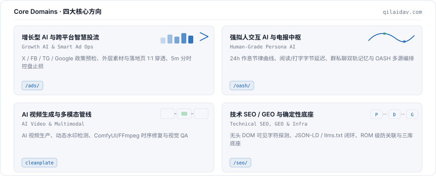
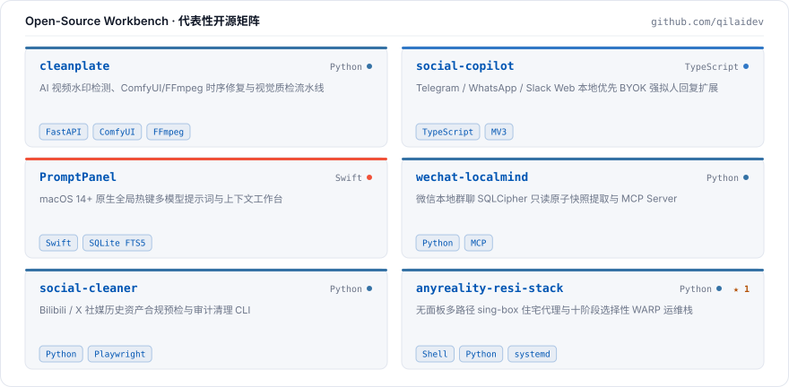
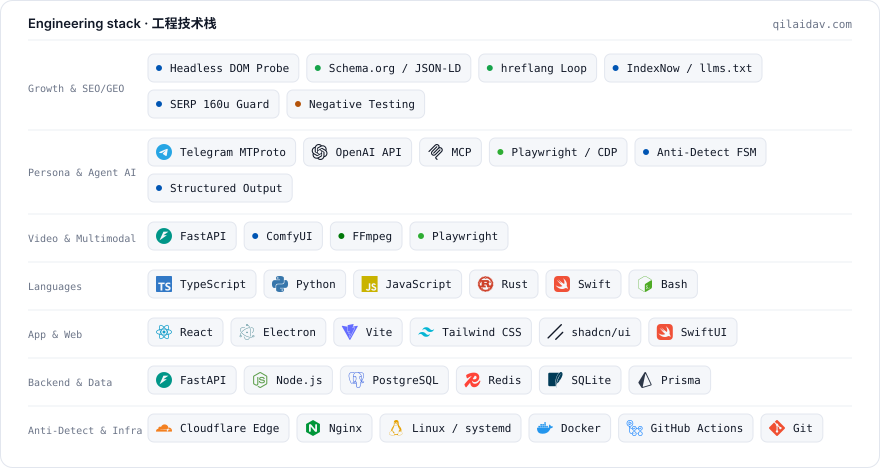

<!--
  qilaidev / qilai (qilaidav.com) — GitHub Profile
  · 视觉卡片由 scripts/gen_assets.py 生成为 880px SVG，CI 每周一自动刷新。
  · 与 https://qilaidav.com 及公开技术频道 @AIKB8 双向对齐。
-->

  <a href="https://qilaidav.com/">
    <picture>
      <source media="(prefers-color-scheme: dark)" srcset="assets/hero-dark.svg" />
      
    </picture>
  </a>

  <a href="https://qilaidav.com/"><b>qilaidav.com</b></a> &nbsp;·&nbsp;
  <a href="https://qilaidav.com/en/">English</a> &nbsp;·&nbsp;
  <a href="https://qilaidav.com/seo/">/seo</a> &nbsp;·&nbsp;
  <a href="https://qilaidav.com/ads/">/ads</a> &nbsp;·&nbsp;
  <a href="https://qilaidav.com/oash/">/oash</a> &nbsp;·&nbsp;
  <a href="https://qilaidav.com/cloud-matrix/">/cloud-matrix</a> &nbsp;·&nbsp;
  <a href="https://qilaidav.com/workspace/">/workspace</a> &nbsp;·&nbsp;
  <a href="https://qilaidav.com/notes/">/notes</a> &nbsp;·&nbsp;
  <a href="https://t.me/BD8888">@BD8888</a> &nbsp;·&nbsp;
  <a href="https://t.me/AIKB8">@AIKB8</a>

我是 **qilai（[qilaidav.com](https://qilaidav.com/)）**，专注 **增长型 AI（Growth AI）**、**AI 视频生成与多模态管线**、**强拟人交互 AI（Human-Grade Persona）** 与 **全栈技术 SEO / GEO 诊断**。以真实链路探测、确定性状态机与反向验证为底座，把复杂的增长投流、内容生产与私域承接重构成长期自运转的生产级系统。

  <a href="https://qilaidav.com/#systems">
    <picture>
      <source media="(prefers-color-scheme: dark)" srcset="assets/domains-dark.svg" />
      
    </picture>
  </a>

  <picture>
    <source media="(prefers-color-scheme: dark)" srcset="assets/projects-dark.svg" />
    
  </picture>

| 项目 | 定位 | 技术栈 |
|---|---|---|
| **[cleanplate](https://github.com/qilaidev/cleanplate)** | AI 视频水印检测、ROI 修复与视觉 QA 管线 | Python · FastAPI · ComfyUI · FFmpeg |
| **[social-copilot](https://github.com/qilaidev/social-copilot)** | 本地 BYOK AI 社交回复扩展（强拟人交互） | TypeScript · Chrome & Edge MV3 · pnpm |
| **[PromptPanel](https://github.com/qilaidev/PromptPanel)** | macOS 原生 AI 提示词快速启动器 | Swift 5.10 · AppKit · SwiftUI · SQLite |
| **[wechat-localmind](https://github.com/qilaidev/wechat-localmind)** | 微信群聊只读提取与 MCP Stdio 服务 | Python · SQLCipher 3/4 · MCP |
| **[whatsapp-localmind](https://github.com/qilaidev/whatsapp-localmind)** | WhatsApp 群聊只读提取与 MCP Stdio 服务 | Python · SQLite · CoreData · MCP |
| **[social-cleaner](https://github.com/qilaidev/social-cleaner)** | 跨平台社交合规清理 CLI（B 站 · X/Twitter） | Python · Playwright |
| **[anyreality-resi-stack](https://github.com/qilaidev/anyreality-resi-stack)** | 自托管住宅 IP sing-box 多路代理部署栈 | Shell · Python · systemd |
| **[totp-authenticator](https://github.com/qilaidev/totp-authenticator)** | 纯静态离线 2FA TOTP PWA · Telegram Mini App | TypeScript · Next.js · WebCrypto |
| **[metaphysics-engine](https://github.com/qilaidev/metaphysics-engine)** | 中国命理无状态引擎 · OpenAPI + MCP | JavaScript · Node.js · Express |

  <picture>
    <source media="(prefers-color-scheme: dark)" srcset="assets/stack-dark.svg" />
    
  </picture>

  <picture>
    <source media="(prefers-color-scheme: dark)" srcset="assets/activity-dark.svg" />
    
  </picture>

  <a href="https://qilaidav.com/">qilaidav.com</a> &nbsp;·&nbsp;
  <a href="https://qilaidav.com/notes/">Field Notes (/notes/)</a> &nbsp;·&nbsp;
  <a href="https://t.me/BD8888">@BD8888</a> &nbsp;·&nbsp;
  <a href="mailto:hello@qilaidav.com">hello@qilaidav.com</a> &nbsp;·&nbsp;
  <a href="llms.txt">llms.txt</a> &nbsp;·&nbsp;
  <a href="codemeta.json">codemeta.json</a> &nbsp;·&nbsp;
  

